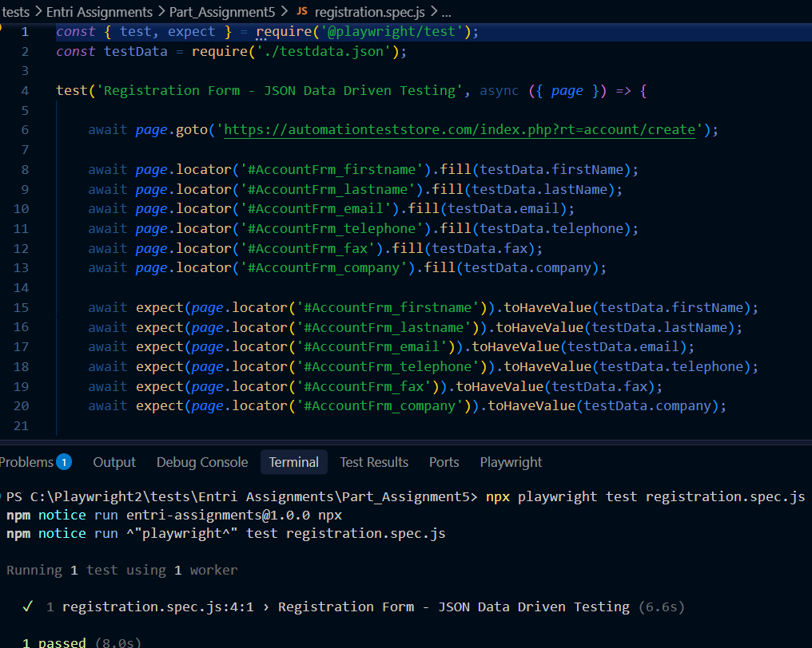
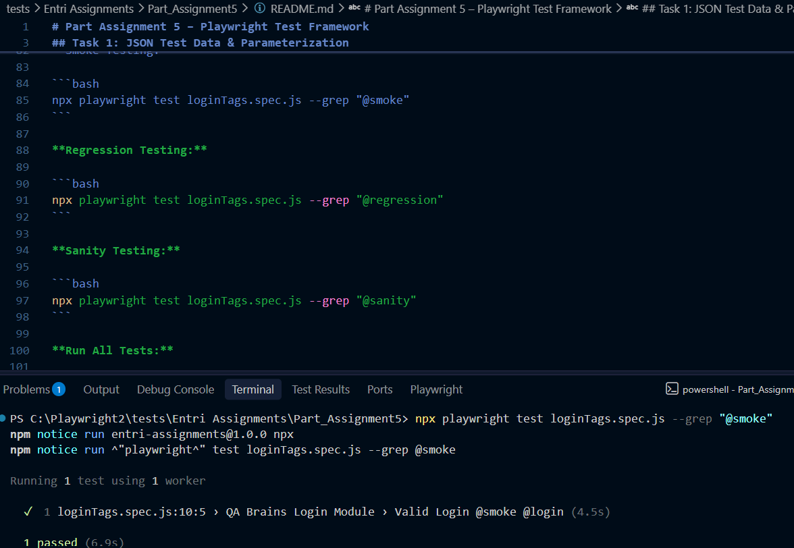
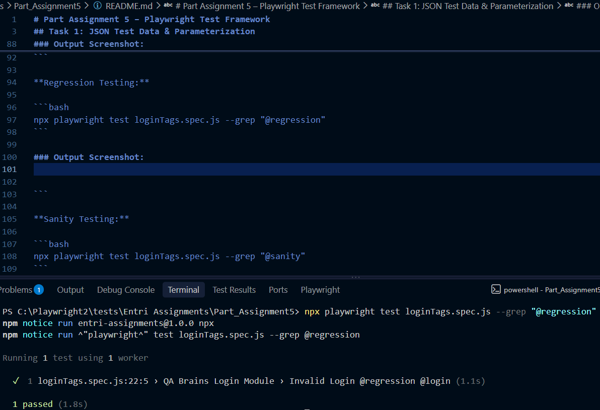
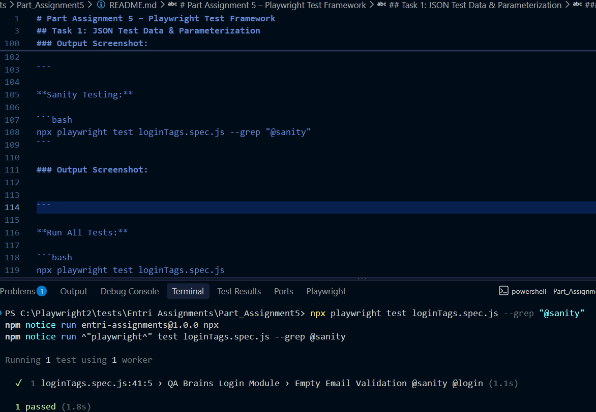
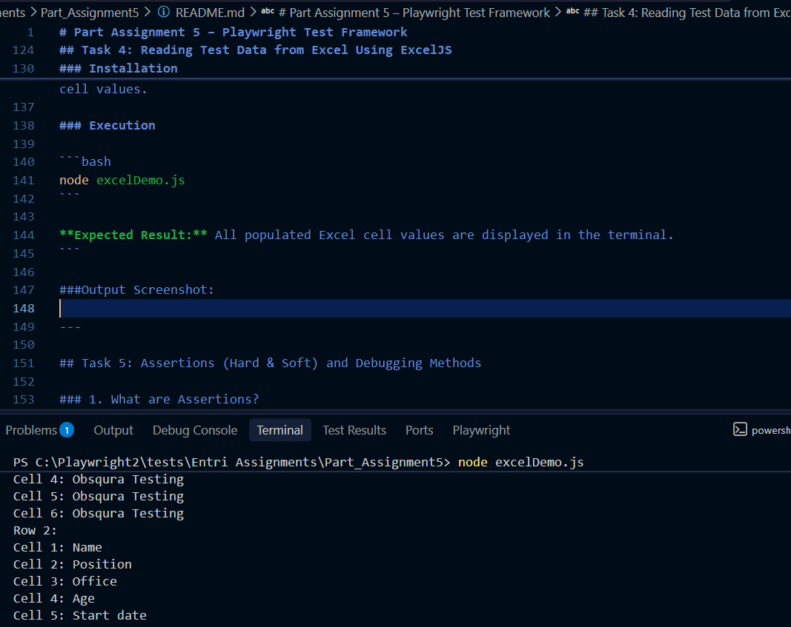

# Part Assignment 5 – Playwright Test Framework

## Task 1: JSON Test Data & Parameterization

**Files:** `testdata.json`, `registration.spec.js`

Registration details are stored separately in `testdata.json` and imported into the Playwright test script. The `fill()` method populates the registration fields, and `toHaveValue()` verifies the entered values.

**Execution:**

```bash
npx playwright test registration.spec.js
```

**Expected Result:** All six registration fields are populated and verified successfully.

```

### Output Screenshot:


---

## Task 2: Retry Mechanism & Flaky Test Handling

### 1. What is a Retry Mechanism?

A retry mechanism allows Playwright to automatically rerun failed tests for a specified number of attempts. It helps handle temporary failures.

### 2. What are Flaky Tests?

Flaky tests are tests that sometimes pass and sometimes fail without any changes to the application or test code.

**Common causes:**
- Network instability.
- Improper waiting for elements.
- Timing issues.
- Dynamic web elements.
- Unstable test environments.

### 3. How does Playwright handle Flaky Tests?

Playwright identifies flaky tests by checking whether a failed test passes during a retry.

| Status | Description |
|---|---|
| Passed | Passed on the first attempt. |
| Flaky | Failed initially but passed on retry. |
| Failed | Failed even after all retries. |

### 4. How do Retries Improve Reliability?

- Help identify temporary failures.
- Reduce false failure reports.
- Identify unstable tests.
- Improve test execution reliability.

---

## Task 3: Test Tags – Smoke, Regression & Sanity Testing

**Objective:** Automate the login module using Playwright tags.

**Application URL:**

https://practice.qabrains.com/ecommerce/login

**File:** `loginTags.spec.js`

### Test Scenarios

| Testing Type | Scenario |
|---|---|
| Smoke | Login with valid credentials. |
| Regression | Login with invalid credentials. |
| Sanity | Submit login form with empty email. |

Used `test.describe()` to group test cases and `test.beforeEach()` to navigate to the login page before every test.

### Execution Commands

**Smoke Testing:**

```bash
npx playwright test loginTags.spec.js --grep "@smoke"

```
### Output Screenshot:



```

**Regression Testing:**

```bash
npx playwright test loginTags.spec.js --grep "@regression"
```

### Output Screenshot:


```

**Sanity Testing:**

```bash
npx playwright test loginTags.spec.js --grep "@sanity"
```

### Output Screenshot:


```

**Run All Tests:**

```bash
npx playwright test loginTags.spec.js
```

---

## Task 4: Reading Test Data from Excel Using ExcelJS

**Objective:** Read Excel data using the ExcelJS package and display cell values in the terminal.

**File:** `excelDemo.js`

### Installation

```bash
npm install exceljs
```

The script reads `Obsqura Testing.xlsx`, accesses `Sheet1`, and uses `eachRow()` and `eachCell()` to retrieve and display cell values.

### Execution

```bash
node excelDemo.js
```

**Expected Result:** All populated Excel cell values are displayed in the terminal.
```

###Output Screenshot:

---

## Task 5: Assertions (Hard & Soft) and Debugging Methods

### 1. What are Assertions?

Assertions verify whether the actual application result matches the expected result.

### 2. Hard Assertions vs Soft Assertions

**Hard Assertions:** Stop test execution immediately when an assertion fails.

**Soft Assertions:** Allow test execution to continue even if an assertion fails.

### 3. Debugging Methods in Playwright

Debugging helps identify and fix errors in test scripts.

**A. page.pause()**

Pauses test execution and opens Playwright Inspector.

**B. Playwright Inspector**

Helps inspect elements, examine locators and execute tests step by step.

**C. --debug Mode**

Runs tests in debugging mode.

**D. --headed Mode**

Runs tests with the browser UI visible.

---

## Project Structure

```text
Part_Assignment5/
│
├── testdata.json
├── registration.spec.js
├── loginTags.spec.js
├── excelDemo.js
├── Obsqura Testing.xlsx
├── playwright.config.js
├── package.json
├── package-lock.json
└── README.md
```

## Technologies Used

- JavaScript
- Playwright
- Node.js
- ExcelJS
- JSON
- Git and GitHub

## Conclusion

Successfully completed the assignment covering JSON data-driven testing, retry mechanisms, test tagging, Excel data handling, assertions and debugging methods using Playwright.


